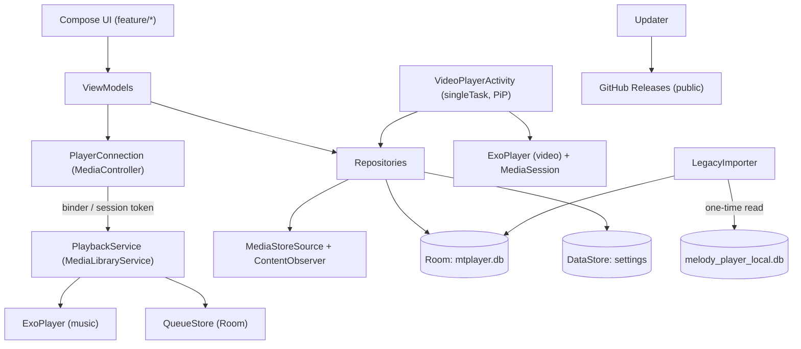

# Architecture — MT Player 2.0

## Requirements

### Functional

- Local audio: library by songs, albums, artists, folders, genres; playlists; favourites;
  recently/most played; local search; synced/plain local lyrics (`.lrc`, `.txt`, embedded
  USLT); queue with reorder/remove/play-next; shuffle; repeat; sleep timer (with
  finish-song and fade-out); equalizer, bass boost, virtualizer; playback speed.
- Background playback with MediaSession notification, lock screen, headset/Bluetooth keys,
  audio focus, becoming-noisy pause.
- Local video: list/grid, folders, favourites, continue watching, hidden folders; player
  with brightness/volume/seek gestures, double-tap seek, pinch zoom, aspect modes,
  orientation, lock, speed, audio/subtitle track selection, external `.srt/.vtt/.ass`
  subtitles, PiP, resume.
- Settings for theme, playback, video gestures, library scanning, history, updates.
- In-app updater from public GitHub Releases with signature verification.

### Non-functional

| Concern | Target |
|---|---|
| Scale | 200k MAU, devices from 2 GB RAM / API 28 to flagships and Android TV |
| Cold start | First frame < 1 s on mid-range; library shown from memory cache, refreshed in background |
| Memory | No leaks across long sessions; image memory cache 12 % of heap on low-RAM, 20 % otherwise |
| Responsiveness | No disk or MediaStore I/O on the main thread; StrictMode in debug |
| Reliability | Notification appears for every playing session on API 28–36; state survives process death |
| Privacy | No analytics, no network except the user-visible update check |
| Security | No secrets in APK; only the updater receiver exported where required |
| Accessibility | WCAG AA text contrast (4.5:1) in every theme; 48 dp touch targets; content descriptions |

## High-level structure

Single Gradle module, package-by-feature. Splitting into modules buys little for one team
and slows builds (see ADR-002).



## Packages

```
com.mtplayer.app
├── MTApp, AppContainer            manual DI, process-wide singletons
├── core/        crash, dispatchers, device class, format, permissions
├── data/
│   ├── media/   MediaStoreSource, LibraryIndex, models (Song, Album, Artist, Video…)
│   ├── db/      Room entities, DAOs, migrations, LegacyImporter
│   ├── prefs/   SettingsStore (DataStore)
│   └── repo/    LibraryRepository, UserDataRepository, LyricsRepository
├── playback/    PlaybackService, PlayerConnection, QueueStore, SleepTimer, AudioFx
├── video/       VideoPlayerActivity, gestures, subtitles, PiP
├── designsystem/ theme, tokens, components, feedback (snackbar host, dialogs, sheets)
├── feature/     home, library, nowplaying, queue, search, saved, settings, onboarding
└── update/      UpdateChecker, ApkVerifier, Installer, UI
```

## Key flows

- **Play a song:** UI → `PlayerConnection.play(queue, index)` → controller
  `setMediaItems` → service player prepares → Media3 posts the notification and promotes
  the service to foreground. Queue snapshot written to Room (debounced 1 s) and
  position every 10 s while playing plus on pause/stop.
- **Process death:** on next launch the service restores the snapshot via
  `MediaSession.Callback.onPlaybackResumption` (also used by System UI "resume" on API 33+)
  and the UI shows the restored mini player paused at the saved position.
- **Video:** the library starts `VideoPlayerActivity` with the video id and the current
  list. It owns its own ExoPlayer and MediaSession (so PiP and headset controls work) and
  pauses music through audio focus.
- **Library refresh:** `ContentObserver` on audio/video URIs → debounce 2 s → re-query on
  `Dispatchers.IO` → publish immutable `LibraryIndex` via `StateFlow`.

## Failure modes and fallbacks

| Failure | Handling |
|---|---|
| Permission denied / permanently denied | Dedicated screen explaining why, button to settings; app still usable for settings |
| File deleted while queued | Player error → skip to next after 1 failure, toast-free inline banner; drop missing items on restore |
| Notification permission denied (API 33+) | Playback continues; one-time explanatory card in settings |
| Corrupt Room DB | Room migrations are explicit; no destructive fallback. If opening fails, the DB is renamed (kept) and a fresh one created, with a crash log entry |
| Old DB import fails | Import is idempotent and retried next launch; old DB is never deleted |
| Update check offline | Silent for background check; clear message for manual check |
| Low memory (`onTrimMemory`) | Clear Coil memory cache, drop lyric/subtitle caches |
